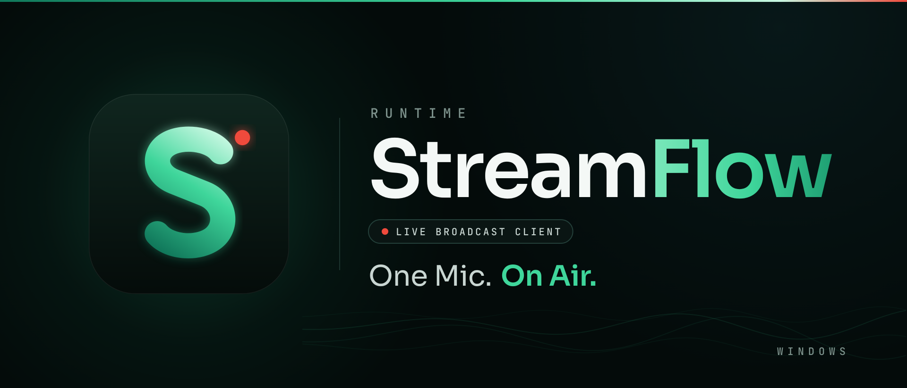

# Runtime StreamFlow

Il programma con cui i DJ di **Runtime Radio** vanno in onda. Prende l'audio del
computer, lo codifica in MP3 e lo manda al server della radio (AzuraCast), al posto
di BUTT. Server, porta e qualità sono già impostati: il DJ sceglie il proprio studio,
scrive la password una volta e preme **Vai in onda**.

Oggi è pensato per il team di Runtime Radio: l'elenco degli studi e l'indirizzo del
server sono nel programma. Una versione per tutti, configurabile, verrà dopo.

## Scaricare e installare

1. Scarica l'ultima versione dalla pagina
   [Releases](https://github.com/Pitz72/StreamFlow-/releases/latest): il file
   `Runtime-StreamFlow-<versione>-x64.exe`.
2. Avvialo. L'installer non è firmato: se Windows mostra un avviso blu, scegli
   **Ulteriori informazioni**, poi **Esegui comunque**.
3. Non servono permessi di amministratore.

Funziona su **Windows 10 e 11 a 64 bit**. Non esistono versioni per macOS e Linux.

**Aggiornamenti.** Dalla 0.10.0 StreamFlow si aggiorna da solo: scarica la versione
nuova in sottofondo e, quando non sei in onda, una finestra chiede se installarla
subito o alla chiusura. Impostazioni e password memorizzate restano.

## Andare in onda

1. **Configurazione → DJ e accesso**: scegli il tuo studio e scrivi la password.
   Se lasci attivo «Ricorda la password», viene salvata cifrata da Windows, e solo
   dopo una diretta riuscita.
2. **Configurazione → Audio e Mix**: scegli il dispositivo di ingresso (mixer,
   scheda audio o microfono).
3. Premi **Vai in onda**. La scritta diventa **In onda** solo quando il server sta
   davvero ricevendo l'audio da qualche secondo.

Nella schermata principale ci sono anche il volume del microfono, regolabile in
diretta, e le barre di livello. **Now Playing** manda al player il nome del
programma e dell'autore.

### MIX MODE: solo un microfono USB, niente mixer

Se hai solo un microfono, attiva **MIX MODE** in Configurazione → Audio e Mix.
StreamFlow somma la tua voce a **tutto** quello che il computer sta suonando: la
regia di Runtime Live Machine Pro o di qualunque altro programma, ma anche notifiche
e browser. Non servono driver né cavi virtuali. Ascolta in cuffia: con le casse il
microfono ripiglia la musica.

### Registrazione

In Configurazione → Registrazione puoi salvare una copia MP3 di ogni diretta in
`Documenti\StreamFlow`. Un problema al file (disco pieno) non ferma la diretta.

### Se qualcosa non va

- Se la connessione cade, StreamFlow riprova da solo per qualche minuto.
- **Configurazione → Diagnostica → Test connessione** prova server, porta e
  password e scrive dove si rompe.
- **Apri la cartella dei log** apre i file da mandare a chi ti aiuta. Le password
  non vengono mai scritte nei log.

## Sviluppo

Electron 40, React 19, TypeScript, Tailwind CSS, Zustand, FFmpeg (`ffmpeg-static`),
Vite, electron-builder.

```bash
npm install
npm run electron:dev      # avvio in sviluppo
npm test                  # test
npm run electron:build    # installer in builds/<versione>/, senza pubblicare
```

Il rilascio ai DJ parte solo a mano, dal workflow **Build & Release** su GitHub
Actions: la procedura è in [docs/SETUP.md](./docs/SETUP.md#rilascio-aggiornamento-ai-dj).

## Documentazione

- [docs/INDEX.md](./docs/INDEX.md) — indice di tutta la documentazione
- [docs/ARCHITECTURE.md](./docs/ARCHITECTURE.md) — processi, flusso audio, IPC
- [docs/SETUP.md](./docs/SETUP.md) — prerequisiti, comandi, rilascio
- [docs/CHANGELOG.md](./docs/CHANGELOG.md) — tutte le versioni
- [docs/ROADMAP.md](./docs/ROADMAP.md) — decisioni e lavori aperti

## Licenza

Non ancora scelta: finché non c'è un file di licenza, il codice è visibile ma non
riutilizzabile.
