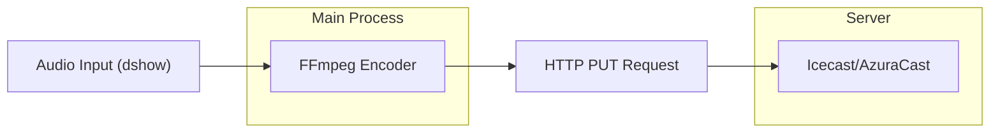

# Architettura di StreamFlow

StreamFlow è basato su un'architettura multi-processo fornita da Electron, che separa la logica di sistema (Backend) dall'interfaccia utente (Frontend).

## 🏗️ Struttura a 3 Layer

Il progetto è organizzato in tre aree principali:

1.  **Main Process (`src/main/`)**:
    - Gestisce il ciclo di vita dell'applicazione.
    - Controlla il motore di streaming via FFmpeg (`streaming/ffmpeg-manager.ts`).
    - Gestisce la comunicazione IPC (Inter-Process Communication).
2.  **Preload Script (`src/preload/`)**:
    - Funge da bridge sicuro tra il Main Process e il Renderer.
    - Espone le API necessarie al frontend tramite `contextBridge`.
3.  **Renderer Process (`src/renderer/`)**:
    - Sviluppato in React 19.
    - Gestisce l'interfaccia utente, la visualizzazione audio e la configurazione dell'utente.
    - Utilizza **Zustand** per la gestione dello stato globale.

## 🌊 Flusso Audio e Streaming

Il cuore di StreamFlow è il processo di encoding e trasmissione:

### Dettagli Tecnici Core:
- **Protocollo**: HTTP PUT (per emulare il comportamento DJ di BUTT).
- **Encoding**: MP3, 128kbps CBR, 44100Hz (canali come da sorgente input).
- **VU Meter**: Volume mono (media RMS) visualizzato su entrambi i canali L/R.
- **Backend Task Management**: Utilizzo di `taskkill` su Windows per garantire la chiusura pulita di FFmpeg.

## 💾 Gestione dello Stato

Lo stato dell'applicazione è gestito tramite Zustand con il middleware `persist`:
- **Persistenti**: Credenziali (user, pass, host), mount point, ID dispositivo audio.
- **Volatili**: Stato ON AIR, tempo di streaming, stato connessione (esclusi tramite `partialize`).

---

> Per una guida su come modificare questi componenti, consulta [SETUP.md](./SETUP.md).
